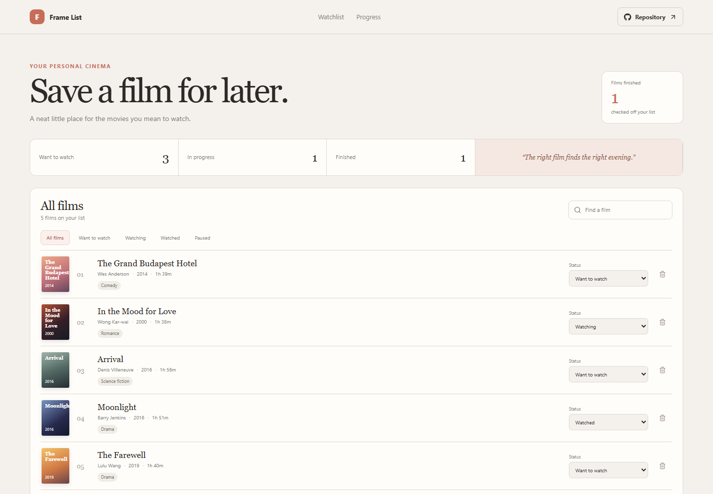

# Movie Watchlist

Frame List keeps a personal film queue in one place so a movie night starts with choosing a title, not remembering where it was saved.

**Live site:** [https://a2rp.github.io/movie-watchlist/](https://a2rp.github.io/movie-watchlist/)

## Interface

A completion summary sits above the watchlist. The list shows a film title, director, year, runtime, genre, and status. Search and status tabs narrow the list, while the add form creates a new entry.

## Features and use

Add a film by title. Use its Status selector to move it between Want to watch, Watching, Paused, and Watched. Search by title, director, or genre. Remove a title with the trash button and confirm in the dialog; Cancel, Escape, or clicking outside keeps it.

## Data and limits

Films and their statuses are saved in localStorage in the current browser profile. New entries get the current year and default notes; this version lets you update status but does not edit the other film details. No account or external catalog is used.

## Run locally

Use Node.js and npm, then run these commands from the project folder:

```sh
npm install
npm run dev
```

Run ESLint and create a production build with:

```sh
npm run lint
npm run build
```

## Deployment

The public app is published with GitHub Pages. Build and publish the current version with:

```sh
npm run deploy
```

Vite builds with the /movie-watchlist/ project-page base path.

## Future improvements

These are ideas and are not implemented yet:

- Add editable metadata such as director, release year, runtime, and personal rating.
- Import and export the watchlist as a JSON file.

## Links

- Portfolio: [https://www.ashishranjan.net](https://www.ashishranjan.net)
- GitHub: [https://github.com/a2rp](https://github.com/a2rp)
- CodePen: [https://codepen.io/ash1198](https://codepen.io/ash1198)
- LinkedIn: [https://www.linkedin.com/in/aashishranjan](https://www.linkedin.com/in/aashishranjan)
- Facebook: [https://www.facebook.com/theash.ashish/](https://www.facebook.com/theash.ashish/)
- YouTube: [https://www.youtube.com/@ashishranjan-ashz?sub_confirmation=1](https://www.youtube.com/@ashishranjan-ashz?sub_confirmation=1)
- Email: [mailto:ash.ranjan09@gmail.com](mailto:ash.ranjan09@gmail.com)

## Support

- Support: [https://a2rp-donation-page.netlify.app/](https://a2rp-donation-page.netlify.app/)
- Buy Me a Coffee: [https://buymeacoffee.com/ashishranjan](https://buymeacoffee.com/ashishranjan)
- Patreon: [https://www.patreon.com/ashishranjan](https://www.patreon.com/ashishranjan)
